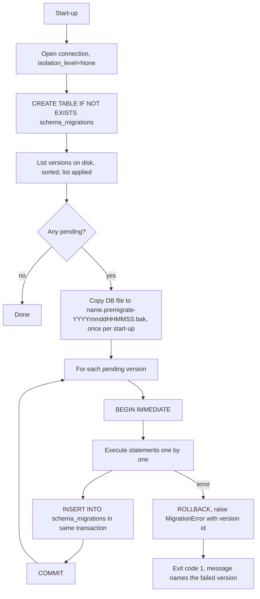
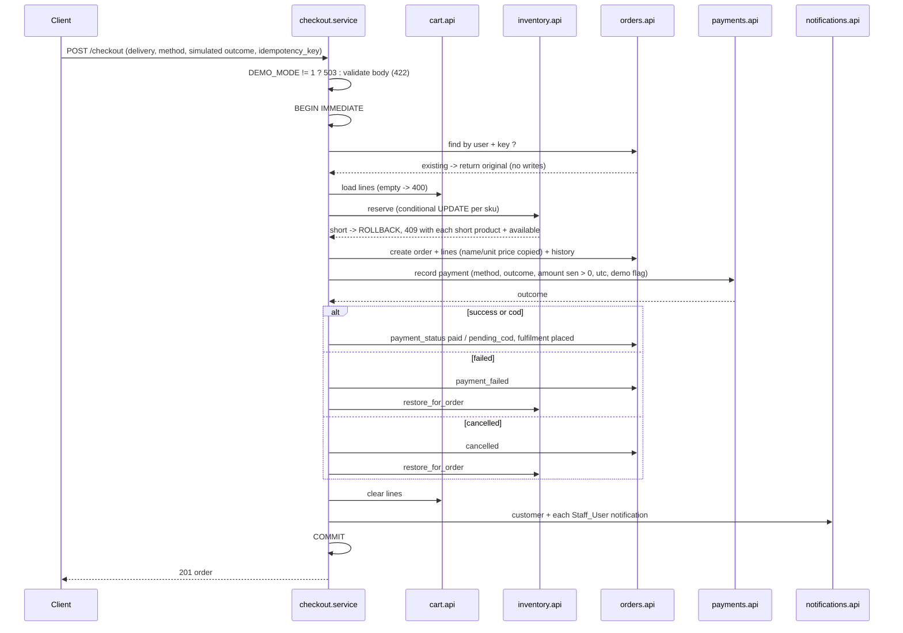

# Design Document

## Overview

The Sagemaker Asia Mobile Platform is an independent university prototype (not an official Sagemaker product, no private Sagemaker backend, all payments simulated, all demo data labelled). It has two parts:

- **Mobile_App**: Flutter (Material 3) for web, Android and desktop, using Riverpod for state, a feature-based folder structure and one app with two experiences (customer, and seller/admin/artisan).
- **Backend_API**: a modular FastAPI REST service under `/api`, backed by SQLite with a versioned, non-destructive migration runner. SQL is isolated in repositories so the schema can later move to PostgreSQL.

This design is a **migration, not a rewrite**. The workspace already contains working behaviour that must keep working:

| Existing asset | What it does today | What the design does with it |
|---|---|---|
| `lib/main.dart` (~1,200 lines, 52 KB) | `FavoritesStore`, `CartStore`, `OrdersStore` (ChangeNotifier + SharedPreferences keys `sagemaker_saved_product_ids`, `sagemaker_demo_cart_v1`, `sagemaker_demo_orders_v1`), `money()`, `DemoApi`, `Product`, `loadProducts()` (server first with a 3 s timeout, then bundled JSON), Home/Shop/Favourites/Cart/Checkout/Orders/About pages, status steps `placed, packing, shipped, delivered` | Split into feature folders. Every store becomes a Riverpod notifier. The old SharedPreferences keys are read once as guest data and migrated on sign-in (Req 10.10, 11.12). `money()` output is preserved exactly. The bundled-JSON fallback is kept for offline browsing. |
| `backend/server.py` | Single file. `orders` table (`DEMO-` IDs, `secret_token`, `checkout_id` UNIQUE idempotency, `items_json`, status `placed/packing/shipped/delivered`), flat 800 sen delivery, `X-Order-Token` guest tracking, `X-Admin-Key` status endpoint, `DEMO_MODE` 503 guard, prices read from `assets/products.json`, CORS from `ALLOWED_ORIGINS` | Decomposed into modules. The table and its rows are kept. Guest/legacy endpoints stay available under `/api/legacy` with unchanged request/response shapes. |
| `backend/test_server.py` | 3 smoke tests: product list, checkout + token tracking + admin status, server-side price enforcement | Kept and re-pointed at `/api/legacy` through one `LEGACY_PREFIX` constant, so the same inputs and expected outputs still pass (Req 1.1). |
| `backend/admin_update.py` | CLI to advance an order using `SAGEMAKER_ADMIN_KEY` | Kept, pointed at the legacy route. Marked deprecated in favour of the staff UI. |
| `backend/demo_orders.sqlite3` | Existing order data | Never modified by a rewrite. A byte-for-byte backup is taken before the first pending migration, and migrations only add. |
| `assets/products.json` | 4 products with `id` (`fishing`, `hikayat`, `pouch`, `jendela`), `demoPriceSen` | Remains the offline fallback. The Seed_Script inserts these 4 products with identifiers preserved (Req 29.11). |
| `pubspec.yaml` | `http`, `shared_preferences` | Adds Riverpod, go_router, secure storage, charts and test libraries. |
| `backend/requirements.txt` | `fastapi`, `uvicorn` | Adds validation, hashing, data, upload and test libraries. |

### Key design decisions

1. **Add-only migrations over a baseline.** Migration `0001_baseline` creates the legacy `orders` table with `IF NOT EXISTS` (a no-op on an existing prototype DB). Later migrations only `CREATE TABLE` and `ALTER TABLE ... ADD COLUMN` with nullable or defaulted columns. Legacy `orders` rows are never rewritten, so Req 1.2 holds by construction.
2. **Reuse the `orders` table.** New orders go into the same table. Legacy NOT NULL columns (`secret_token`, `items_json`, `delivery_address`, `checkout_id`, `payment_method`, ...) are filled by the new checkout, so old and new orders live side by side. New columns (`user_id`, `source`, `is_demo`, `stock_restored`, ...) are nullable or defaulted.
3. **Legacy status `packing` is mapped, not rewritten.** The API reads `packing` as `preparing` (Req 22.13) and never writes it.
4. **Module ownership of tables.** Each backend module owns its tables. Cross-module access goes through a module's `api.py` with explicit functions that take the caller's open connection. This keeps checkout atomic (Req 14.2) while still honouring Req 1.6. An architecture test enforces ownership.
5. **Stock lives in the `inventory` module** (`stock_levels`, `stock_adjustments`), not on `products`. That makes the ledger invariant (Req 21.8) a single-module guarantee.
6. **`BEGIN IMMEDIATE` for every write transaction.** SQLite then serialises writers, which gives oversell protection (Req 14.4). A conditional `UPDATE ... WHERE quantity >= ?` is the second line of defence, and a `CHECK (quantity >= 0)` is the third.
7. **Legacy endpoints are namespaced, not overloaded.** The old `GET /api/products` returns a bare list. The new one must return the `items/total/limit/offset` envelope (Req 28.8). Both cannot share a path, so the legacy shapes move to `/api/legacy/*` (see Open Decisions).
8. **Forecasting is a pure function over a pandas Series.** The Forecasting_Service has an I/O shell (reads monthly units through `orders.api`) and a pure core (`forecast_series`) that is deterministic and fully property-testable.

### Open decisions for review

- **O1 Legacy path move.** `GET /api/products` changes shape; the old shape is served at `GET /api/legacy/products`. The legacy `POST /api/orders`, `GET /api/orders/{id}` (token) and `PATCH /api/admin/orders/{id}/status` also move under `/api/legacy`. `/api/orders/{id}` is reused for the authenticated customer view. Alternative: keep the old paths and put the new API under `/api/v1`, but Req 28 and the checklist assume `/api`.
- **O2 Revenue definition.** Req 19.6 excludes `cancelled` and `payment_failed`; the AOV glossary says "paid". The design counts an order as revenue when its fulfilment status is not `cancelled`/`payment_failed` **and** payment status is `paid`, `pending_cod` or the legacy `demo_simulated_not_charged`. A COD order is recognised at placement because the demo flow has no cash-collection step.
- **O3 Production trigger.** Req 24.1 says "quantity exceeds the available finished stock". Stock is already deducted at checkout, so the design evaluates it at confirmation as: the product is `made_to_order`, or the line quantity is greater than the stock remaining after deduction.
- **O4 Artisan navigation.** Req 5.10 routes Artisan_User to the seller/admin navigation, but Req 6.8/6.10 restrict them to assigned jobs. The design uses the staff shell filtered by role, so an Artisan_User sees only a Production destination.
- **O5 Env var strictness.** Req 1.9 says missing variables stop start-up, while Req 2.8 and 33.7 define behaviour for unset `ALLOWED_ORIGINS` and `DEMO_MODE`. Only `DATABASE_PATH` is mandatory; the others are optional with strict validation when present.

## Architecture

```mermaid
flowchart LR
  subgraph Client[Flutter Mobile_App]
    UI[Screens / Widgets] --> RP[Riverpod providers]
    RP --> REPO[Feature repositories]
    REPO --> API[ApiClient: base URL, token, timeouts, error mapping]
    REPO --> LOCAL[(SharedPreferences / secure storage)]
  end
  API -- HTTPS JSON /api --> MW
  subgraph Server[FastAPI Backend_API]
    MW[NoSniff ASGI wrapper + CORS + error handlers] --> RT[Routers]
    RT --> DEP[Dependencies: auth, RBAC_Guard, pagination]
    DEP --> SVC[Module services]
    SVC --> REP[Repositories - SQL only]
    SVC -. api.py calls with open connection .-> SVC2[Other module services]
    REP --> DB[(SQLite)]
    MR[Migration_Runner] --> DB
    FC[Forecasting pure core: pandas + NumPy] --- SVC
  end
  SEED[Seed_Script] --> DB
```

### Request lifecycle

1. The outermost ASGI wrapper adds `X-Content-Type-Options: nosniff` to every response, including those produced by the server-error middleware (Req 33.2).
2. `CORSMiddleware` runs with the origins from `ALLOWED_ORIGINS` (empty list means no CORS headers), methods `GET, POST, PUT, PATCH, DELETE` and headers `Content-Type, Authorization` only, with credentials disabled (Req 2.7 to 2.9).
3. The router validates body and query against Pydantic models (Req 28.1).
4. Dependencies resolve the session (hash lookup, expiry check), then the RBAC_Guard checks the Role.
5. A service opens a transaction through `db.transaction()`, calls repositories and other modules' `api.py`, and commits or rolls back.
6. Exception handlers convert `AppError`, validation errors and unexpected exceptions into the error envelope (see Error Handling).

### Backend module layout

```
backend/
  requirements.txt            requirements-dev.txt
  server.py                   # thin shim: `from app.main import application as app`, keeps `python backend/server.py`
  admin_update.py             # kept (legacy)
  test_server.py              # kept (legacy smoke tests, LEGACY_PREFIX)
  seed.py                     # Seed_Script entry (python -m backend.seed [--reset])
  migrate.py                  # `python -m backend.migrate [status|up]`
  app/
    main.py                   # create_app(settings) factory, middleware, routers, handlers, lifespan -> migrations
    config.py                 # Settings.from_env(): DATABASE_PATH, ALLOWED_ORIGINS, TOKEN_LIFETIME_SECONDS, DEMO_MODE, MEDIA_DIR, APP_TIMEZONE
    db.py                     # connect(), transaction() (BEGIN IMMEDIATE), PRAGMAs, row helpers
    errors.py                 # AppError hierarchy + handlers + error envelope
    security.py               # password hashing (argon2), token generation/hash, constant-time compare
    logging_setup.py          # redaction filter (password hashes, token hashes, artisan contact)
    uploads.py                # image validation (extension + magic bytes + size) and safe storage
    pagination.py             # PageParams(limit 1..100, offset >= 0) and Page envelope
    money.py                  # Money_Sen helpers, integer-only rounding
    time_utils.py             # utc_now_iso(), month bucketing in APP_TIMEZONE
    migrations/
      runner.py               # Migration_Runner
      versions/
        0001_baseline.sql     0002_users_auth.sql     0003_catalogue.sql   0004_inventory.sql
        0005_orders_extend.sql  0006_cart_favourites.sql  0007_payments.sql
        0008_artisans_production.sql  0009_custom_orders.sql  0010_notifications_settings.sql
        0011_indexes.sql
    modules/
      auth/            router.py service.py repository.py schemas.py api.py
      users/           (profile, addresses, favourites, role admin)
      categories/
      products/        (catalogue, variations, images, home sections)
      cart/
      checkout/        (orchestration only, owns no tables)
      payments/
      orders/
      inventory/
      artisans/
      production/
      custom_orders/
      notifications/
      analytics/
      forecasting/     (service.py = I/O shell, model.py = pure pandas/NumPy core)
      settings/
      legacy/          (compat router: /api/legacy/*)
      health/
  tests/
    conftest.py        # temp DB per run, deleted at teardown
    unit/ api/ property/ architecture/ e2e/
```

Each module has the same five files: `router.py` (HTTP only), `service.py` (rules, transactions), `repository.py` (SQL only), `schemas.py` (Pydantic), `api.py` (the only import other modules may use).

### Table ownership (enforced by an architecture test)

| Module | Owned tables |
|---|---|
| auth | `sessions`, `login_attempts` |
| users | `users`, `addresses`, `favourites` |
| categories | `categories` |
| products | `products`, `product_variations`, `product_images` |
| inventory | `stock_levels`, `stock_adjustments`, `inventory_settings` |
| cart | `cart_lines` |
| orders | `orders`, `order_lines`, `order_history` |
| payments | `payments` |
| artisans | `artisans` |
| production | `production_jobs`, `production_progress` |
| custom_orders | `custom_orders`, `custom_order_images` |
| notifications | `notifications` |
| settings | `app_settings` |
| (runner) | `schema_migrations` |

The architecture test parses each module's `repository.py` for table names after `FROM|JOIN|INTO|UPDATE|DELETE FROM` and fails if a name is not in its own row. A second check fails if a module imports another module's `repository`, `service` or `schemas` instead of `api`.

### Migration_Runner



- SQLite DDL is transactional, so a failed migration rolls back completely. The runner splits a `.sql` file into statements (using `sqlite3.complete_statement`) and runs them one at a time inside the explicit transaction. It never uses `executescript`, which would commit implicitly.
- A version already in `schema_migrations` is skipped (Req 1.4). The version is inserted in the same transaction as the schema change (Req 1.3).
- A version file is `NNNN_name.sql`, or `NNNN_name.py` exposing `up(conn)` for data steps. Applied files are immutable.
- A failure in `lifespan` start-up raises `SystemExit(1)` after printing `Migration failed: <version>: <cause>` (Req 1.5).
- The `.bak` copy is a safety net for the existing `demo_orders.sqlite3`. It is not a restore mechanism the runner uses automatically.
- To move to PostgreSQL later: replace `db.py`, make the `?` placeholder style configurable in repositories, and translate the few SQLite-specific bits (`AUTOINCREMENT`, `strftime`) which this design keeps inside repositories.

## Components and Interfaces

### Backend cross-cutting components

**Settings (`config.py`)**

| Variable | Rule | Behaviour on missing or invalid |
|---|---|---|
| `DATABASE_PATH` | required; legacy alias `SAGEMAKER_DEMO_DB` accepted | exit 1, message names `DATABASE_PATH` |
| `ALLOWED_ORIGINS` | optional comma list; each must be an absolute http(s) origin | unset or empty → no CORS headers; invalid entry → exit 1 naming the variable |
| `TOKEN_LIFETIME_SECONDS` | optional integer 3600 to 2592000, default 604800 (7 days) | out of range or non-integer → exit 1 naming the variable |
| `DEMO_MODE` | optional; exactly `1` enables payments | any other value, unset or empty → payments return 503 (Req 33.7); never a fallback secret |
| `MEDIA_DIR` | optional, default `<DATABASE_PATH dir>/media` | invalid path → exit 1 |
| `APP_TIMEZONE` | optional IANA name, default `Asia/Kuala_Lumpur` | invalid → exit 1 |
| `SAGEMAKER_ADMIN_KEY` | optional, legacy endpoint only | empty → legacy admin endpoint always 403 (as today) |

There is no hard-coded secret anywhere. Demo account passwords come from env vars read by the Seed_Script (Req 29.10). The legacy default `ALLOWED_ORIGINS` of `localhost:5353` is dropped; it moves to `.env.example`.

**Security (`security.py`)**: argon2id through `argon2-cffi` (bcrypt is the permitted alternative). Session tokens are `secrets.token_urlsafe(32)`, stored as `sha256` hex. Lookups compare hashes with `hmac.compare_digest`.

**RBAC_Guard (`deps.py`)**: FastAPI dependencies:

- `current_session()`: 401 `unauthenticated` when the header is missing, malformed, unknown, revoked, or expired (an expired token returns code `session_expired`, Req 33.1).
- `require_roles(*roles)`: 403 `forbidden` when the Role does not match.
- `require_staff` = `require_roles('seller','admin')`, `require_admin`, `require_customer`.
- Artisan ownership checks happen in the production service because they need the job (`production.api.assert_job_assigned_to_user`).
- Customer ownership is enforced in repositories by always filtering on `user_id`. A foreign or missing id yields the same `not_found` response (Req 6.9, 15.4).

**Permission matrix** (rows are endpoint groups, columns are Roles):

| Group | visitor | customer | seller | admin | artisan |
|---|---|---|---|---|---|
| health, catalogue read, home sections, public artisan | yes | yes | yes | yes | yes |
| register, login | yes | yes | yes | yes | yes |
| profile, addresses, favourites, cart, checkout, own orders/payments, own custom orders, own notifications | no | own | no | no | no |
| `/api/staff/*` products, inventory, orders, artisans, custom orders, analytics, forecast, settings | no | no | yes | yes | no |
| `/api/staff/notifications` equivalents use `/api/notifications` | no | own | own | own | no |
| role change, deactivate | no | no | no | yes | no |
| production jobs (list, detail, progress) | no | no | all | all | assigned only |

**Error layer (`errors.py`)**: `AppError(status, code, message, details=None)` and subclasses `NotFound`, `Conflict`, `Forbidden`, `Unauthenticated`, `ValidationFailed`. Handlers are registered for `AppError`, `RequestValidationError`, `StarletteHTTPException` and bare `Exception`.

**Logging**: a `logging.Filter` on the root logger redacts `password`, `password_hash`, `token`, `token_hash`, `phone`, `email` and `address` values for artisan-related records at every level (Req 33.5). Services never log whole row dictionaries from `users` or `sessions`.

**Uploads (`uploads.py`)**: `validate_image(filename, data) -> ext`. Accepts `.jpg/.jpeg`, `.png`, `.webp` only. Checks magic bytes (`FF D8 FF`; `89 50 4E 47 0D 0A 1A 0A`; `RIFF....WEBP`), requires the signature type to equal the extension type, and requires `len(data) <= 5 * 1024 * 1024`. The server reads at most 5 MB + 1 byte. Stored filename is `uuid4().hex + ext`; the client name is never used on disk.

### Backend module interfaces

**auth**: `register`, `login`, `logout`, `validate_session`.

- Registration: name 1–100, email 3–254 in valid format (compared case-insensitively via a `email_lower` unique column), password 8–128 with at least one letter and one digit. A supplied `role` is ignored (Req 4.5). Failures: 409 duplicate, 422 listing fields, 500 `registration_failed` with a rolled-back transaction.
- Login: lookup by `email_lower`; always run one argon2 verify (against a dummy hash for unknown emails) so timing is similar; the same message `Invalid email or password` for unknown email and wrong password (Req 5.2).
- Lockout: each failed attempt inserts a `login_attempts` row keyed by `email_lower`. If 5 failures exist within the preceding 10 minutes and the fifth failure was less than 5 minutes ago, the response is 429 with `retry_after_seconds` even for correct credentials (Req 5.3). A successful login outside lockout clears that email's failures.
- `GET /api/auth/session` validates the token and returns user, role, expiry.

**users**: profile (name 1–100, phone 8–15 digits), addresses (CRUD, default flag handled in one transaction: clear others then set), favourites (idempotent `PUT`/`DELETE`, silently hiding inactive products while retaining rows), admin role change and deactivation. Orders keep their own delivery copy, so deleting an address changes no order (Req 7.7).

**categories**: seeded by migration `0003`: tote bags, fabric books, toys, gifts, accessories (Req 9.13).

**products**: list/search/filter/sort/paginate, detail, staff CRUD, images, activate/deactivate, delete rules, home sections.

- SQL for list: `WHERE is_active = 1 AND (lower(name) LIKE ? ESCAPE '\' OR lower(description) LIKE ? ESCAPE '\') AND category_id = ? ORDER BY price_sen {ASC|DESC}, name ASC LIMIT ? OFFSET ?` plus a `COUNT(*)` using the same `WHERE`. The LIKE pattern escapes `%`, `_` and `\` from the query so the search is a true substring match.
- Home: `best_sellers` uses `orders.api.units_sold_since(conn, days=90)` and sorts by units desc then `created_at` desc, limited to 10 active products; `new_arrivals` orders by `created_at` desc; `recommendations` uses `users.api.favourite_product_ids` and `orders.api.purchased_product_ids`, picks active products from those categories excluding purchased ones, and falls back to best sellers (same order) when the user has no signal (Req 8.4, 8.5).
- Public product JSON includes `priceSen` (integer), plus `demoPriceSen` as an alias so the unchanged client model parser keeps working; `isDemo`; stock status computed from `inventory.api`; and `artisan: {id, name}` (public name only).
- Delete: `orders.api.product_in_any_order` → 409 `product_in_orders` recommending deactivation (Req 20.9).

**inventory**: `get_level`, `adjust`, `set_threshold`, `history`, plus functions for other modules: `reserve_for_order(conn, lines, order_id, actor)`, `restore_for_order(conn, order_id)`, `initialise(conn, product_id, variation_id, quantity, threshold)`.

- `adjust`: delta non-zero integer in ±999,999,999, reason 1–255, runs `UPDATE stock_levels SET quantity = quantity + ? WHERE sku_key = ? AND quantity + ? >= 0`; rowcount 0 → 409 `insufficient_stock`; success inserts `stock_adjustments`. After a decrease, if quantity ≤ threshold it calls `notifications.api.low_stock(conn, product_id)`.
- Low-stock flag = `quantity <= low_stock_threshold`. For a product with variations the product-level figure is the sum of its variation quantities.
- `restore_for_order` checks `orders.api.mark_stock_restored(conn, order_id)` (an atomic `UPDATE orders SET stock_restored = 1 WHERE id = ? AND stock_restored = 0`; rowcount 1 means proceed). That makes restoration happen at most once (Req 14.10).

**cart**: lines keyed by `(user_id, sku_key)`. `view(conn, user_id)` recomputes from current prices and stock every time. `add`, `set_quantity`, `remove`, `merge`. Validation order for add: quantity integer 1–20 → 422; resulting line quantity ≤ 20 → 422 `line_limit`; stock check against available → 409 `insufficient_stock` with `available`. Delivery fee is 800 sen when at least one available line exists, else 0. Unavailable lines (inactive product/variation or zero stock) are returned with `available=false` and are excluded from `subtotalSen`, `grandTotalSen` (Req 11.7).

**checkout**: `POST /api/checkout`, orchestration only.



The cart is cleared for every outcome that creates an order, matching Req 12.8 (the flow only says "checkout succeeds"; a `failed` order is retried from the order screen, not from the cart). Everything between `BEGIN IMMEDIATE` and `COMMIT` is one transaction (Req 14.2).

- Order ID: `SM-` plus 10 characters drawn with `secrets.choice` from `A-Z0-9`. A unique-violation retries with a new id (up to 5 times).
- Idempotency: the stored `checkout_id` column is `"{user_id}:{idempotency_key}"` (the legacy column stays globally UNIQUE and also scopes the key to the user). A repeat returns the original order with HTTP 200 and no writes.
- Legacy required columns are filled for new orders: `secret_token` random (unused by the new API), `items_json` the line snapshot, `delivery_address` the joined address, `payment_method` the new method, and `shipping_fee_sen`, `total_sen`.
- Payment retry (`POST /api/orders/{id}/payments`): only for the owner, only when the order is `payment_failed`. On `success` it re-reserves stock for every line inside one transaction; if any line is short it rolls back and returns 409 listing the short items, leaving the order in `payment_failed` (Req 13.11, 13.12). Earlier Payment_Records are never updated; a new one is inserted.
- Outcome mapping:

| Method / outcome | payment status | Fulfilment_Status | Stock |
|---|---|---|---|
| card/fpx/ewallet + success | `paid` | `placed` | stays deducted |
| card/fpx/ewallet + failed | `failed` | `payment_failed` | restored |
| card/fpx/ewallet + cancelled | `cancelled` | `cancelled` | restored |
| cod | `pending_cod` | `placed` | stays deducted |

**payments**: `record(conn, order_id, method, outcome, amount_sen, ...)`; `GET /api/orders/{id}/payments` for the owner and staff. A `payments.is_demo = 1` flag is always written. No card number ever reaches the server: the request schema has no such field and `extra='forbid'`.

**orders**: customer list/detail, staff list/filter/search/detail, status change.

- Allowed transitions: `placed→confirmed→preparing→shipped→delivered`; `cancelled` from `placed|confirmed|preparing`. A stored `packing` is normalised to `preparing` before validation. Any other request is 409 `invalid_transition` naming current and requested.
- `shipped` requires `shipping_reference` 3–80 characters; `cancelled` requires `reason` 3–500 characters.
- A change inserts `order_history(order_id, previous_status, new_status, actor_user_id, reason, created_at)` and calls `notifications.api.order_status_changed` only when the status really changed (Req 17.4). Cancellation calls `inventory.api.restore_for_order`.
- Confirming an order calls `production.api.create_jobs_for_order(conn, order_id)`.
- Customer detail embeds `productionLabel` (read-only, separate from the timeline) when a job exists (Req 15.10).
- The customer timeline is rendered from `order_history`; legacy orders with no history rows get a synthetic first entry from `created_at` when read (never written).
- Staff filter validation: status not in the seven values → 422 `invalid_filter`. Search is `lower(id) LIKE ? OR lower(customer_name) LIKE ?`.

**artisans**: staff CRUD and detail (assigned products, open and completed job counts via `production.api.counts_for_artisan`), public view with `publicName`, `specialisation`, `story` only (the serializer is a separate Pydantic model, so private fields cannot leak). Setting `unavailable` with open jobs succeeds and returns `warnings: [{code: 'open_jobs', jobIds: [...]}]`.

**production**: staff list (filters `status`, `artisan_id`, `priority` combined with AND; `view=list|board` only changes grouping in the response), manual create, assign, status transitions, progress.

- Allowed status transitions: `order_confirmed→production_assigned→in_production→quality_checking→completed→ready_for_fulfilment`, plus `quality_checking→in_production`.
- Assign requires status `order_confirmed`; sets `production_assigned`, stores quantity 1–999,999, deadline (not before today in `APP_TIMEZONE`), priority (default `normal`), notes ≤ 1000.
- Progress: integer 0–100 else 422; note ≤ 500; an Artisan_User must own the job else 403.
- `overdue` is computed on read: `today > deadline AND status NOT IN (completed, ready_for_fulfilment)`.
- Production status and Fulfilment_Status are in different tables and no code path writes both (Req 24.10). Reaching `ready_for_fulfilment` only creates a staff notification.

**custom_orders**: customer create (multipart, up to 5 images validated by `uploads.py`, all-or-nothing: files are written to temp names, moved and recorded only after the whole request validates, and removed again if the DB transaction fails), list, detail; staff list/filter, accept (price 1–99,999,999), reject (reason 5–500 after trim), assign artisan (active artisan, status `accepted`, no existing assignment; assignment and `production_jobs` row in one transaction), status to `in_progress`/`completed`. Allowed transitions: `submitted→accepted`, `submitted→rejected`, `accepted→in_progress`, `in_progress→completed`; the rest are 409.

**notifications**: `create(conn, user_id, type, title, body, related)`, list with `unreadCount`, mark one or all read. Helper functions: `order_created`, `order_status_changed`, `custom_order_created`, `custom_order_status_changed`, `low_stock` (skips staff with an unread low-stock row for the same product), `production_ready`. Creation happens in the caller's transaction, so the "within 5 seconds" criteria hold trivially. No e-mail, SMS or push (Req 17.11).

**analytics**: reads only through `orders.api.sales_rows(conn, start, end)` (revenue-eligible orders with lines), `inventory.api.low_stock_count`, `production.api.open_job_count`, `inventory.api.distribution_by_category`.

- All money is integer sen. `aov = (revenue * 2 + count) // (2 * count)` (round half up, 0 when count is 0).
- Monthly buckets use `APP_TIMEZONE` and include zero months in chronological order. Total revenue is computed as the sum of the monthly values, so the invariant (Req 26.7) holds by construction and the test guards the construction.
- Range validation: start > end → 422 `invalid_range`; span > 24 months → 422 `range_too_long`.
- Dashboard: KPIs `totalRevenueSen`, `orderCount`, `pendingOrders` (status `placed` or `confirmed`), `aovSen`, `lowStockCount`, `openProductionJobs`, `shippedOrderCount`; series `salesByMonth` (last 12 months), `ordersByStatus` (all seven keys), `bestSellers` (top 5 by units, excluding cancelled/payment_failed), `inventoryByCategory`.

**settings**: `GET/PUT /api/staff/settings` for staff-adjustable values (default low-stock threshold for new products). Small by design; connection settings stay on the device.

**legacy**: re-implements the old contract on top of the new services where reasonable:

| Legacy route | Behaviour kept |
|---|---|
| `GET /api/legacy/products` | bare JSON list from `assets/products.json` shape (`demoPriceSen`, `imageUrl`, `productUrl`), generated from the products table |
| `POST /api/legacy/orders` | body `checkout_id`, `customer_name`, ..., `payment_method` `demo_card|demo_fpx|demo_ewallet`, `items`; 201 with `accessToken`; 409 on repeated `checkout_id`; 400 on unknown product; server price only; `DEMO-` ID; status `placed`; payment status `demo_simulated_not_charged`. It writes a guest order (`user_id` NULL) through the same reserve-stock path, so legacy orders also deduct stock. |
| `GET /api/legacy/orders/{id}` | `X-Order-Token` required (401), wrong token 404 |
| `PATCH /api/legacy/admin/orders/{id}/status` | `X-Admin-Key`, flow `placed→packing→shipped→delivered`, backwards 400, 403 without key |

Legacy orders are visible to Staff_Users in the staff Orders list (they have `user_id` NULL and `source = 'legacy'`).

**health**: `GET /api/health` → `{ok: true, service: 'sagemaker-prototype', demoMode: bool}` with no DB write.

### API endpoint catalogue

All paths are prefixed with `/api`. Lists return `{items, total, limit, offset}`. `Auth` shows the minimum Role.

| Method and path | Auth | Purpose | Req |
|---|---|---|---|
| GET `/health` | none | status + demo flag | 28.6 |
| POST `/auth/register` | none | create customer | 4 |
| POST `/auth/login` | none | token + role | 5 |
| POST `/auth/logout` | any | revoke token | 5.7 |
| GET `/auth/session` | any | validate token | 5.5 |
| GET, PUT `/me` | customer | profile | 7 |
| GET, POST `/me/addresses` | customer | list, create | 7 |
| PUT, DELETE `/me/addresses/{id}` | customer | update, delete | 7 |
| PUT `/me/addresses/{id}/default` | customer | set default | 7.6 |
| PATCH `/users/{id}/role`, POST `/users/{id}/deactivate` | admin | role admin | 6.5, 6.6 |
| GET `/categories` | none | categories | 9.13 |
| GET `/products` | none | search, filter, sort, paginate | 9 |
| GET `/products/{id}` | none (staff sees inactive) | detail | 9.10, 9.14 |
| GET `/home/best-sellers`, `/home/new-arrivals` | none | home sections | 8 |
| GET `/home/recommendations` | optional | personalised or fallback | 8.4, 8.5 |
| GET `/favourites` | customer | list | 10 |
| PUT, DELETE `/favourites/{product_id}` | customer | add, remove (idempotent) | 10 |
| POST `/favourites/merge` | customer | merge local favourites | 10.10 |
| GET `/cart` | customer | server-priced cart | 11 |
| POST `/cart/lines` | customer | add quantity | 11.1 |
| PUT `/cart/lines` | customer | set quantity (0 removes) | 11.8 |
| DELETE `/cart/lines/{line_id}` | customer | remove line | 11.8 |
| POST `/cart/merge` | customer | merge guest cart, returns `notMerged` | 11.12, 11.13 |
| POST `/checkout` | customer | create order + payment | 12–14 |
| POST `/orders/{id}/payments` | customer | retry after `payment_failed` | 13.11 |
| GET `/orders`, GET `/orders/{id}` | customer | own orders, tracking | 15 |
| GET `/orders/{id}/payments` | customer | own payment records | 6.3 |
| GET, POST `/custom-orders` | customer | list, create (multipart) | 16 |
| GET `/custom-orders/{id}` | customer | own detail | 16, 6.9 |
| GET `/media/{filename}` | customer (own) or staff | custom-order reference images | 16.2 |
| GET `/notifications` | any signed-in non-artisan | list + unread count | 17.6 |
| POST `/notifications/{id}/read`, `/notifications/read-all` | same | mark read | 17.7 |
| GET `/artisans`, GET `/artisans/{id}` | none | public view only | 23.5 |
| GET, POST `/staff/products`; GET, PUT, DELETE `/staff/products/{id}` | staff | manage products | 20 |
| PATCH `/staff/products/{id}/active` | staff | activate, deactivate | 20.3, 20.4 |
| POST `/staff/products/{id}/images` | staff | upload image | 20.5 |
| PUT `/staff/products/{id}/artisan` | staff | link, unlink (`null`) | 23.7 |
| GET `/staff/inventory` | staff | list with low-stock flag, `low_only` filter | 21.1 |
| GET `/staff/inventory/{product_id}` | staff | level | 21.1 |
| POST `/staff/inventory/{product_id}/adjustments` | staff | adjust stock | 21.2 |
| GET `/staff/inventory/{product_id}/adjustments` | staff | history | 21.7 |
| PUT `/staff/inventory/{product_id}/threshold` | staff | set threshold | 21.5 |
| GET `/staff/orders`, GET `/staff/orders/{id}` | staff | filter `status`, `q` | 22 |
| POST `/staff/orders/{id}/status` | staff | transition (`shipping_reference`, `reason`) | 22 |
| GET, POST `/staff/artisans`; GET, PUT `/staff/artisans/{id}` | staff | artisan admin, private contact | 23 |
| GET `/production/jobs`, GET `/production/jobs/{id}` | staff or artisan (own only) | list, detail | 24, 6.7 |
| POST `/production/jobs` | staff | manual create | 24.2 |
| POST `/production/jobs/{id}/assign` | staff | assign artisan | 24.3 |
| POST `/production/jobs/{id}/status` | staff | transition | 24.4 |
| POST `/production/jobs/{id}/progress` | staff or assigned artisan | progress | 24.6 |
| GET `/staff/custom-orders` | staff | list, `status` filter | 25.1, 25.2 |
| POST `/staff/custom-orders/{id}/accept`, `/reject`, `/assign-artisan`, `/status` | staff | manage | 25 |
| GET `/staff/analytics/dashboard` | staff | KPIs + series | 19 |
| GET `/staff/analytics/sales?start&end` | staff | range analytics | 26 |
| GET `/staff/forecast/{product_id}` | staff | forecast | 27 |
| GET, PUT `/staff/settings` | staff | settings | 6.4 |
| GET/POST/PATCH `/legacy/...` | legacy rules | compatibility | 1.1 |

### Forecasting approach

The Forecasting_Service is split in two parts.

- **Shell (`service.py`)**: calls `orders.api.monthly_units(conn, product_id)`, which returns `(month 'YYYY-MM', units, has_synthetic)` rows from revenue-eligible order lines, grouped by month in `APP_TIMEZONE`. It also reads stock and threshold via `inventory.api`, builds the response and the `synthetic` flag (true when any contributing order has `source = 'synthetic'`).
- **Core (`model.py`)**: `forecast_series(units: pd.Series, stock: int, threshold: int) -> ForecastResult`, a pure function with no clock, random numbers or I/O (Req 27.13).

Steps in the core:

1. **History.** Reindex to a continuous `PeriodIndex` from the first to the last month, filling gaps with 0 (Req 27.1). The last month is the last month with data, not the current month, so the function does not depend on the clock.
2. **Baseline_Model.** Mean of the last `min(3, n)` values, repeated for each of the next 3 months.
3. **Candidate_Model.** Ordinary least squares with `numpy.linalg.lstsq` on features `[1, t]`, plus 11 month-of-year dummy columns only when `n >= 24` (the seasonal terms need at least two cycles). Plain NumPy keeps the dependency set small; scikit-learn is not required.
4. **Clamp and round.** Each prediction is `max(0.0, x)` rounded to 2 decimals (Req 27.12).
5. **Backtest** when `n >= 6`: fit each model on `values[:-2]`, predict 2 steps, compare with `values[-2:]`. MAE is `mean(|e|)`, RMSE is `sqrt(mean(e²))`, both rounded to 2 decimals (Req 27.3). Selected model is the candidate when `candidate_MAE < baseline_MAE`, else the baseline (ties go to the baseline, Req 27.5).
6. **Short history** (`n < 6`): baseline forecast only; `candidate`, `mae`, `rmse` are `null`; `evaluation: {available: false, reason: 'insufficient_history'}` (Req 27.4).
7. **Replenishment flag**: `stock < next_month_forecast + threshold` using the selected model's first predicted month (the baseline when evaluation is unavailable) (Req 27.7).
8. **Methodology** is a constant object with four non-empty strings: `data`, `models`, `evaluation`, `limitations` (Req 27.8). No other accuracy numbers are emitted (Req 27.9).
9. **Errors**: no history rows → 422 `forecast_no_history`; any exception in the core → 500 `forecast_failed` through the generic handler path, with a safe message (Req 27.11).

Response shape:

```json
{
  "productId": "fishing",
  "synthetic": true,
  "history": [{"month": "2025-01", "units": 12}],
  "baseline": {"forecast": [{"month": "2026-02", "units": 14.0}]},
  "candidate": {"forecast": []},
  "evaluation": {"available": true, "holdoutMonths": 2,
    "baseline": {"mae": 2.5, "rmse": 3.0}, "candidate": {"mae": 2.1, "rmse": 2.8}},
  "selectedModel": "candidate",
  "replenish": true,
  "methodology": {"data": "...", "models": "...", "evaluation": "...", "limitations": "..."}
}
```

Synthetic history comes from the Seed_Script: it creates orders with `source = 'synthetic'`, `is_demo = 1`, backdated `created_at`, spread over at least 12 consecutive months ending on the run date, at least one sale per month, and a deterministic generator seeded with a fixed constant. The forecast screen therefore always shows the Synthetic_Data notice for seeded data.

### Mobile_App structure (Flutter + Riverpod)

```
lib/
  main.dart                       # thin: ProviderScope(child: SagemakerApp()); legacy prefs boot in a provider
  app/
    app.dart                      # MaterialApp.router, theme, locale
    theme.dart                    # Material 3 ColorScheme: primary #123D32, secondary #87A999, bg #F8F5EE, accent #E9C879, text #26332E, surfaces #FFFFFF, radius 12-16
    router.dart                   # go_router + role redirect (routerProvider)
    shells/ customer_shell.dart  staff_shell.dart
  core/
    config/api_config.dart        # ApiConfigNotifier: override > --dart-define API_BASE_URL > platform default
    network/api_client.dart       # wraps http.Client, adds Bearer token, timeouts, maps errors to AppFailure
    network/app_failure.dart      # sealed: Network, Timeout, Server, Unauthorized, Forbidden, Validation(fields), Conflict, NotFound
    storage/ token_store.dart  legacy_local_store.dart
    money.dart                    # formatRm(int sen), identical output to old money()
    validators.dart               # name, email, phone (MY), postcode, address, state, password, URL
    constants.dart                # 16 states, categories, Fulfilment/Production statuses
    widgets/ loading_view.dart error_view.dart empty_view.dart demo_label.dart badge_count.dart section_title.dart
  features/
    auth/          data/ state/ ui/   # login, register, session
    home/
    catalogue/     # shop, product detail, product model (+ offline JSON fallback)
    favourites/
    cart/
    checkout/      # 4-step flow
    payment/
    orders/        # my orders, tracking timeline
    custom_orders/
    notifications/
    profile/       # profile, addresses
    about/
    settings/      # connection settings (API_Base_URL)
    admin/
      dashboard/ orders/ products/ inventory/ artisans/ production/ analytics/ forecasting/ notifications/ settings/
```

Each feature folder has `data/` (repository + DTOs, uses `ApiClient`), `state/` (Riverpod providers and notifiers), `ui/` (screens and widgets). Features may depend on `core/` and on another feature's `state/` public providers only.

**Riverpod design** (Riverpod 2.x `Notifier`/`AsyncNotifier`, no code generation):

| Provider | Type | Role |
|---|---|---|
| `sharedPreferencesProvider` | `FutureProvider` | async init, failure tolerated (as `main()` does today) |
| `apiConfigProvider` | `AsyncNotifierProvider` | base URL resolution and validated override (Req 2) |
| `apiClientProvider` | `Provider` | rebuilds when the base URL or token changes, so a saved URL applies without restart |
| `sessionProvider` | `AsyncNotifierProvider<SessionState>` | `checking / signedOut / signedIn(user) / serverUnreachable`; validates stored token at start; on 401 deletes token |
| `routerProvider` | `Provider<GoRouter>` | redirect by session and role; remembers the requested location for post-login return (Req 18.7, 18.8) |
| `productListProvider` | `AsyncNotifierProvider.family<ProductQuery>` | q, category, sort, limit, offset |
| `productDetailProvider` | `FutureProvider.family<String>` | one product |
| `homeSectionsProvider` | three independent `FutureProvider`s | one section failing does not affect the rest (Req 8.8) |
| `favouritesProvider` | `AsyncNotifierProvider` | server list when signed in; local guest list otherwise; first-sign-in merge |
| `cartProvider` | `AsyncNotifierProvider` | server cart when signed in, `GuestCartRepository` otherwise (same prefs key `sagemaker_demo_cart_v1`); merge on login |
| `cartBadgeProvider` | derived `Provider<String?>` | `null` when 0, `"99+"` above 99 |
| `checkoutFlowProvider` | `NotifierProvider` | step 0–3, delivery form values (kept on error), idempotency key generated once per attempt |
| `ordersProvider`, `orderDetailProvider.family` | async | paging, keeps last data when refresh fails (Req 15.9) |
| `notificationsProvider`, `unreadCountProvider` | async/derived | badge `"99+"` above 99 |
| `customOrdersProvider` | async | list and create |
| `staff*Provider`s | async | dashboard, staff orders, products, inventory, artisans, production, analytics, forecast |

**Navigation**

- Customer shell: bottom `NavigationBar` with exactly Home, Shop, Favourites, Cart, Profile (Req 18.1). Other screens are routes: `/product/:id`, `/checkout`, `/payment/:orderId`, `/confirmation/:orderId`, `/orders`, `/orders/:id`, `/notifications`, `/custom-orders`, `/about`, `/login`, `/register`, `/settings/connection`.
- Staff shell: Dashboard, Orders, Products, Production, More (Inventory, Artisans, Analytics, Forecasting, Notifications, Settings) in that order (Req 19.1). A `RolePermissions` map filters destinations: Artisan_User gets Production only, showing their assigned jobs.
- Guarded customer destinations (Favourites, checkout, Profile, My Orders) redirect to `/login?from=<location>` when signed out; cancelling returns to the previous route (Req 18.7, 18.8).

**Migrating `main.dart` pieces**

| Old | New |
|---|---|
| `FavoritesStore` | `features/favourites/state/favourites_provider.dart` + `LocalFavouritesRepository` (same key) |
| `CartStore` (clamp 1–20, same key) | `GuestCartRepository` + `cartProvider` |
| `OrdersStore` (`SavedOrder(id, token)`) | `LegacyOrdersRepository` reads old saved orders and lists them in My Orders as "legacy guest orders" via the legacy token route, so earlier order tracking is not lost |
| `money(int)` | `core/money.dart: formatRm` |
| `DemoApi.placeOrder/getOrder` | `checkout/data` and `orders/data` repositories |
| `Product`, `loadProducts()` | `catalogue/data/product.dart` (accepts `priceSen` or `demoPriceSen`) and `ProductRepository` with the same server-first, bundled-JSON fallback (offline browsing only; add-to-cart needs the server) |
| `AppShell`, `HomePage`, `ShopPage`, ... | split into the feature `ui/` folders; widget code is moved first, behaviour changes second, so each move can be checked with the existing screens |
| `const apiBaseUrl = String.fromEnvironment('API_BASE_URL')` | `ApiConfigNotifier` default |

**Cross-cutting UI behaviour**

- `AsyncValueView<T>` renders loading (spinner removed within 500 ms of a result), error (reason: network unavailable, timeout or server error; retry action that re-invokes the provider; entered input is kept in the notifier) and empty (message plus one next-step button).
- Timeouts: 10 s for start-up validation and reachability, 15 s for ordinary requests (Req 2.6, 3.5, 5.11).
- `DemoLabel` widget is placed next to demo images, prices and orders, on the login and About screens, the payment and confirmation screens, the dashboard and the forecast screen (Req 3.7 to 3.9, 19.7).
- The payment screen has no real card input. Any shown card field is labelled "demo only, not functional", has no controller wired to the request, and is cleared in `dispose` (Req 13.8, 13.9).
- Charts use `fl_chart` with axis titles or a legend and a `Semantics` widget carrying the values as text (Req 19.4).
- Every `IconButton` takes a required `tooltip`/`semanticLabel` through a wrapper `AppIconButton`.
- The registration screen and first launch show the "fictional personal data only" notice (Req 33.6).

**Dependencies**

`pubspec.yaml` adds `flutter_riverpod`, `go_router`, `flutter_secure_storage`, `fl_chart`, `image_picker`; keeps `http` and `shared_preferences`; dev: `flutter_test`, `mocktail`, `glados`. `flutter_secure_storage` is used on mobile; on web where it is unavailable, it falls back to `shared_preferences` (Req 5.8 "where available"). Exact versions are resolved with `flutter pub add` at implementation time and committed in `pubspec.lock`.

`backend/requirements.txt` adds `pydantic`, `email-validator`, `python-multipart`, `argon2-cffi`, `pandas`, `numpy`; `backend/requirements-dev.txt` adds `pytest`, `httpx`, `hypothesis`. All with version constraints (Req 32.9).

## Data Models

Conventions: primary keys are `TEXT` for products (existing ids preserved), orders and public ids, and `INTEGER` for the rest. Money columns end in `_sen` and are `INTEGER`. Timestamps are ISO-8601 UTC `TEXT`. Booleans are `INTEGER` 0/1. Every table that can hold seeded data has `is_demo INTEGER NOT NULL DEFAULT 0`. `PRAGMA foreign_keys = ON` on every connection.

### Migration plan

| Version | Content | Touches existing data? |
|---|---|---|
| `0001_baseline` | `CREATE TABLE IF NOT EXISTS orders (...)` exactly as `server.py` defines it | No (no-op on an existing DB) |
| `0002_users_auth` | `users`, `sessions`, `login_attempts`, `addresses` | No |
| `0003_catalogue` | `categories` (+ 5 rows), `products`, `product_variations`, `product_images` | No |
| `0004_inventory` | `stock_levels`, `stock_adjustments`, `inventory_settings` | No |
| `0005_orders_extend` | `ALTER TABLE orders ADD COLUMN` for new nullable/defaulted columns; `order_lines`, `order_history` | Adds columns only; no `UPDATE` of legacy values |
| `0006_cart_favourites` | `cart_lines`, `favourites` | No |
| `0007_payments` | `payments` | No |
| `0008_artisans_production` | `artisans`, `production_jobs`, `production_progress` | No |
| `0009_custom_orders` | `custom_orders`, `custom_order_images` | No |
| `0010_notifications_settings` | `notifications`, `app_settings` | No |
| `0011_indexes` | indexes | No |

Legacy `orders` rows are never backfilled. Defaults supply `source = 'legacy'` for rows that existed before (`ALTER TABLE orders ADD COLUMN source TEXT NOT NULL DEFAULT 'legacy'`). New checkout code always writes `source = 'app'` (or `'synthetic'` from the Seed_Script).

### Schema

```sql
-- 0001 baseline (identical to server.py)
CREATE TABLE IF NOT EXISTS orders (
  id TEXT PRIMARY KEY, checkout_id TEXT NOT NULL UNIQUE, secret_token TEXT NOT NULL,
  customer_name TEXT NOT NULL, email TEXT NOT NULL, phone TEXT NOT NULL,
  delivery_address TEXT NOT NULL, payment_method TEXT NOT NULL, payment_status TEXT NOT NULL,
  status TEXT NOT NULL, shipping_fee_sen INTEGER NOT NULL, total_sen INTEGER NOT NULL,
  items_json TEXT NOT NULL, tracking_number TEXT, created_at TEXT NOT NULL, updated_at TEXT NOT NULL
);

CREATE TABLE schema_migrations (version TEXT PRIMARY KEY, applied_at TEXT NOT NULL);

-- 0002
CREATE TABLE users (
  id INTEGER PRIMARY KEY AUTOINCREMENT,
  name TEXT NOT NULL CHECK (length(name) BETWEEN 1 AND 100),
  email TEXT NOT NULL, email_lower TEXT NOT NULL UNIQUE,
  password_hash TEXT NOT NULL,
  phone TEXT,
  role TEXT NOT NULL CHECK (role IN ('customer','seller','admin','artisan')),
  is_active INTEGER NOT NULL DEFAULT 1, is_demo INTEGER NOT NULL DEFAULT 0,
  created_at TEXT NOT NULL, updated_at TEXT NOT NULL
);
CREATE TABLE sessions (
  id INTEGER PRIMARY KEY AUTOINCREMENT,
  user_id INTEGER NOT NULL REFERENCES users(id) ON DELETE CASCADE,
  token_hash TEXT NOT NULL UNIQUE,
  created_at TEXT NOT NULL, expires_at TEXT NOT NULL, revoked_at TEXT
);
CREATE TABLE login_attempts (
  id INTEGER PRIMARY KEY AUTOINCREMENT,
  email_lower TEXT NOT NULL, succeeded INTEGER NOT NULL, attempted_at TEXT NOT NULL
);
CREATE TABLE addresses (
  id INTEGER PRIMARY KEY AUTOINCREMENT,
  user_id INTEGER NOT NULL REFERENCES users(id) ON DELETE CASCADE,
  recipient_name TEXT NOT NULL, phone TEXT NOT NULL,
  line1 TEXT NOT NULL, line2 TEXT, postcode TEXT NOT NULL CHECK (length(postcode) = 5),
  city TEXT NOT NULL, state TEXT NOT NULL, is_default INTEGER NOT NULL DEFAULT 0,
  created_at TEXT NOT NULL, updated_at TEXT NOT NULL
);
CREATE UNIQUE INDEX ux_addresses_default ON addresses(user_id) WHERE is_default = 1;

-- 0003
CREATE TABLE categories (id INTEGER PRIMARY KEY, slug TEXT NOT NULL UNIQUE, name TEXT NOT NULL UNIQUE, sort_order INTEGER NOT NULL);
CREATE TABLE products (
  id TEXT PRIMARY KEY,
  name TEXT NOT NULL CHECK (length(name) BETWEEN 1 AND 200),
  description TEXT NOT NULL DEFAULT '' CHECK (length(description) <= 2000),
  category_id INTEGER NOT NULL REFERENCES categories(id),
  price_sen INTEGER NOT NULL CHECK (price_sen BETWEEN 1 AND 99999999),
  artisan_id INTEGER,                      -- logical link to artisans.id, checked by the service
  made_to_order INTEGER NOT NULL DEFAULT 0,
  is_active INTEGER NOT NULL DEFAULT 1,
  legacy_image_url TEXT, legacy_product_url TEXT,
  is_demo INTEGER NOT NULL DEFAULT 0,
  created_at TEXT NOT NULL, updated_at TEXT NOT NULL
);
CREATE TABLE product_variations (
  id INTEGER PRIMARY KEY AUTOINCREMENT,
  product_id TEXT NOT NULL REFERENCES products(id) ON DELETE CASCADE,
  label TEXT NOT NULL, price_delta_sen INTEGER NOT NULL DEFAULT 0,
  is_active INTEGER NOT NULL DEFAULT 1
);
CREATE TABLE product_images (
  id INTEGER PRIMARY KEY AUTOINCREMENT,
  product_id TEXT NOT NULL REFERENCES products(id) ON DELETE CASCADE,
  filename TEXT, external_url TEXT, sort_order INTEGER NOT NULL DEFAULT 0, is_demo INTEGER NOT NULL DEFAULT 0
);
```

`products.artisan_id` is a logical link only. The `artisans` table is created later in `0008`, and SQLite cannot add a foreign key to an existing table, so the column is unconstrained and `products.service` checks it with `artisans.api.exists()`. This also respects module ownership: the database does not couple `products` to `artisans`. The same applies to the other cross-module id columns (`stock_levels.product_id`, `production_jobs.order_id`, `custom_orders.artisan_id`).

```sql
-- 0004
CREATE TABLE stock_levels (
  sku_key TEXT PRIMARY KEY,                -- product_id or product_id || '#' || variation_id
  product_id TEXT NOT NULL, variation_id INTEGER,
  quantity INTEGER NOT NULL CHECK (quantity >= 0),
  opening_quantity INTEGER NOT NULL CHECK (opening_quantity >= 0)
);
CREATE TABLE inventory_settings (
  product_id TEXT PRIMARY KEY,
  low_stock_threshold INTEGER NOT NULL DEFAULT 5 CHECK (low_stock_threshold BETWEEN 0 AND 999999999)
);
CREATE TABLE stock_adjustments (
  id INTEGER PRIMARY KEY AUTOINCREMENT,
  sku_key TEXT NOT NULL, product_id TEXT NOT NULL,
  delta INTEGER NOT NULL CHECK (delta <> 0),
  reason TEXT NOT NULL CHECK (length(reason) BETWEEN 1 AND 255),
  actor_user_id INTEGER, order_id TEXT,
  created_at TEXT NOT NULL
);

-- 0005 (orders extension: add-only)
ALTER TABLE orders ADD COLUMN user_id INTEGER;                       -- NULL for legacy/guest
ALTER TABLE orders ADD COLUMN source TEXT NOT NULL DEFAULT 'legacy'; -- legacy | app | synthetic
ALTER TABLE orders ADD COLUMN is_demo INTEGER NOT NULL DEFAULT 1;
ALTER TABLE orders ADD COLUMN delivery_postcode TEXT;
ALTER TABLE orders ADD COLUMN delivery_state TEXT;
ALTER TABLE orders ADD COLUMN delivery_notes TEXT;
ALTER TABLE orders ADD COLUMN subtotal_sen INTEGER;
ALTER TABLE orders ADD COLUMN shipping_reference TEXT;               -- mirrors legacy tracking_number
ALTER TABLE orders ADD COLUMN cancel_reason TEXT;
ALTER TABLE orders ADD COLUMN stock_restored INTEGER NOT NULL DEFAULT 0;
ALTER TABLE orders ADD COLUMN stock_restored_at TEXT;
CREATE TABLE order_lines (
  id INTEGER PRIMARY KEY AUTOINCREMENT,
  order_id TEXT NOT NULL REFERENCES orders(id),
  product_id TEXT NOT NULL, variation_id INTEGER, sku_key TEXT NOT NULL,
  name TEXT NOT NULL, variation_label TEXT,
  unit_price_sen INTEGER NOT NULL CHECK (unit_price_sen > 0),
  quantity INTEGER NOT NULL CHECK (quantity BETWEEN 1 AND 20),
  line_total_sen INTEGER NOT NULL
);
CREATE TABLE order_history (
  id INTEGER PRIMARY KEY AUTOINCREMENT,
  order_id TEXT NOT NULL REFERENCES orders(id),
  previous_status TEXT, new_status TEXT NOT NULL,
  actor_user_id INTEGER, reason TEXT, created_at TEXT NOT NULL
);
CREATE TRIGGER order_history_no_update BEFORE UPDATE ON order_history BEGIN SELECT RAISE(ABORT, 'order_history is append-only'); END;
CREATE TRIGGER order_history_no_delete BEFORE DELETE ON order_history BEGIN SELECT RAISE(ABORT, 'order_history is append-only'); END;
```

New orders store the same value in `tracking_number` and `shipping_reference` so the legacy token view and legacy tests keep seeing `trackingNumber`. Legacy rows keep `shipping_reference` NULL and the API reads `COALESCE(shipping_reference, tracking_number)`.

```sql
-- 0006
CREATE TABLE cart_lines (
  id INTEGER PRIMARY KEY AUTOINCREMENT,
  user_id INTEGER NOT NULL REFERENCES users(id) ON DELETE CASCADE,
  product_id TEXT NOT NULL, variation_id INTEGER, sku_key TEXT NOT NULL,
  quantity INTEGER NOT NULL CHECK (quantity BETWEEN 1 AND 20),
  created_at TEXT NOT NULL, updated_at TEXT NOT NULL,
  UNIQUE (user_id, sku_key)
);
CREATE TABLE favourites (
  user_id INTEGER NOT NULL REFERENCES users(id) ON DELETE CASCADE,
  product_id TEXT NOT NULL, created_at TEXT NOT NULL,
  PRIMARY KEY (user_id, product_id)
);

-- 0007
CREATE TABLE payments (
  id INTEGER PRIMARY KEY AUTOINCREMENT,
  order_id TEXT NOT NULL REFERENCES orders(id),
  method TEXT NOT NULL CHECK (method IN ('card','fpx','ewallet','cod')),
  outcome TEXT NOT NULL CHECK (outcome IN ('success','failed','cancelled','pending_cod')),
  amount_sen INTEGER NOT NULL CHECK (amount_sen > 0),
  is_demo INTEGER NOT NULL DEFAULT 1 CHECK (is_demo = 1),
  created_at TEXT NOT NULL
);

-- 0008
CREATE TABLE artisans (
  id INTEGER PRIMARY KEY AUTOINCREMENT,
  user_id INTEGER UNIQUE REFERENCES users(id),
  name TEXT NOT NULL CHECK (length(name) BETWEEN 1 AND 100),
  specialisation TEXT NOT NULL CHECK (length(specialisation) BETWEEN 1 AND 100),
  availability TEXT NOT NULL CHECK (availability IN ('available','busy','unavailable')),
  story TEXT NOT NULL DEFAULT '' CHECK (length(story) <= 2000),
  private_phone TEXT, private_email TEXT, private_address TEXT,
  is_active INTEGER NOT NULL DEFAULT 1, is_demo INTEGER NOT NULL DEFAULT 0,
  created_at TEXT NOT NULL, updated_at TEXT NOT NULL
);
CREATE TABLE production_jobs (
  id INTEGER PRIMARY KEY AUTOINCREMENT,
  order_id TEXT, order_line_id INTEGER, custom_order_id INTEGER,
  product_id TEXT, artisan_id INTEGER,
  quantity INTEGER CHECK (quantity BETWEEN 1 AND 999999),
  deadline TEXT, priority TEXT NOT NULL DEFAULT 'normal' CHECK (priority IN ('low','normal','high','urgent')),
  status TEXT NOT NULL DEFAULT 'order_confirmed'
    CHECK (status IN ('order_confirmed','production_assigned','in_production','quality_checking','completed','ready_for_fulfilment')),
  progress_percent INTEGER NOT NULL DEFAULT 0 CHECK (progress_percent BETWEEN 0 AND 100),
  notes TEXT NOT NULL DEFAULT '' CHECK (length(notes) <= 1000),
  is_demo INTEGER NOT NULL DEFAULT 0, created_at TEXT NOT NULL, updated_at TEXT NOT NULL
);
CREATE TABLE production_progress (
  id INTEGER PRIMARY KEY AUTOINCREMENT,
  job_id INTEGER NOT NULL REFERENCES production_jobs(id) ON DELETE CASCADE,
  percent INTEGER NOT NULL CHECK (percent BETWEEN 0 AND 100),
  note TEXT NOT NULL DEFAULT '' CHECK (length(note) <= 500),
  actor_user_id INTEGER, created_at TEXT NOT NULL
);

-- 0009
CREATE TABLE custom_orders (
  id INTEGER PRIMARY KEY AUTOINCREMENT,
  user_id INTEGER NOT NULL REFERENCES users(id),
  product_type TEXT NOT NULL CHECK (length(product_type) BETWEEN 1 AND 100),
  description TEXT NOT NULL CHECK (length(description) BETWEEN 10 AND 2000),
  quantity INTEGER NOT NULL CHECK (quantity BETWEEN 1 AND 500),
  preferred_date TEXT NOT NULL,
  status TEXT NOT NULL DEFAULT 'submitted'
    CHECK (status IN ('submitted','accepted','rejected','in_progress','completed')),
  estimated_price_sen INTEGER CHECK (estimated_price_sen BETWEEN 1 AND 99999999),
  reject_reason TEXT, artisan_id INTEGER, production_job_id INTEGER,
  is_demo INTEGER NOT NULL DEFAULT 0, created_at TEXT NOT NULL, updated_at TEXT NOT NULL
);
CREATE TABLE custom_order_images (
  id INTEGER PRIMARY KEY AUTOINCREMENT,
  custom_order_id INTEGER NOT NULL REFERENCES custom_orders(id) ON DELETE CASCADE,
  filename TEXT NOT NULL UNIQUE, content_type TEXT NOT NULL, size_bytes INTEGER NOT NULL
);

-- 0010
CREATE TABLE notifications (
  id INTEGER PRIMARY KEY AUTOINCREMENT,
  user_id INTEGER NOT NULL REFERENCES users(id) ON DELETE CASCADE,
  type TEXT NOT NULL CHECK (type IN ('order','custom_order','low_stock','production','system')),
  title TEXT NOT NULL CHECK (length(title) BETWEEN 1 AND 100),
  body TEXT NOT NULL CHECK (length(body) BETWEEN 1 AND 500),
  related_type TEXT, related_id TEXT,
  is_read INTEGER NOT NULL DEFAULT 0, is_demo INTEGER NOT NULL DEFAULT 0, created_at TEXT NOT NULL
);
CREATE TABLE app_settings (key TEXT PRIMARY KEY, value TEXT NOT NULL, updated_at TEXT NOT NULL);

-- 0011
CREATE INDEX ix_orders_user ON orders(user_id, created_at DESC);
CREATE INDEX ix_orders_status ON orders(status, created_at DESC);
CREATE INDEX ix_order_lines_order ON order_lines(order_id);
CREATE INDEX ix_order_lines_product ON order_lines(product_id);
CREATE INDEX ix_products_active_cat ON products(is_active, category_id, price_sen);
CREATE INDEX ix_notifications_user ON notifications(user_id, is_read, created_at DESC);
CREATE INDEX ix_login_attempts ON login_attempts(email_lower, attempted_at);
CREATE INDEX ix_sessions_user ON sessions(user_id);
CREATE INDEX ix_prod_jobs_status ON production_jobs(status, artisan_id, priority);
CREATE INDEX ix_stock_adj_product ON stock_adjustments(product_id, created_at DESC);
```

A unique partial index on `notifications` is not used for the low-stock de-duplication because the rule depends on the unread flag; the service performs `SELECT 1 ... WHERE user_id=? AND type='low_stock' AND related_id=? AND is_read=0` inside the same transaction.

### Legacy data mapping

- `orders.id` `DEMO-XXXXXXXXXX` stays; new ids are `SM-` + 10 characters (Req 14.1).
- `orders.status` may be `packing`; read model maps it to `preparing`.
- `orders.items_json` for legacy rows is parsed on read into the same line shape as `order_lines` (`productId`, `name`, `quantity`, `unitPriceSen`, `lineTotalSen`). New orders write both `order_lines` and `items_json`.
- Seed mapping of the 4 legacy product ids to the new categories: `fishing` and `hikayat` → fabric books, `jendela` → tote bags, `pouch` → accessories. The old category strings (`Kids & Toys`, `Bags`, `Accessories`) are kept in the legacy products route output through a small reverse map.
- A production-job cleanup is not needed: legacy orders have no jobs.

### Server DTO shapes (selected)

```json
// Product
{"id":"fishing","name":"Fishing Mini Busy Book","description":"...","category":{"id":3,"slug":"fabric-books","name":"Fabric books"},
 "priceSen":3500,"demoPriceSen":3500,"isDemo":true,"images":[{"url":"..."}],
 "variations":[{"id":1,"label":"Small","priceDeltaSen":0,"stock":8}],
 "stock":{"quantity":12,"lowStockThreshold":5,"status":"in_stock"},
 "artisan":{"id":2,"name":"Siti"}}

// Cart
{"lines":[{"id":9,"productId":"fishing","variationId":null,"name":"...","unitPriceSen":3500,"quantity":2,
           "lineTotalSen":7000,"available":true,"availableQuantity":12}],
 "subtotalSen":7000,"deliveryFeeSen":800,"grandTotalSen":7800,"itemCount":2}

// Order (customer)
{"id":"SM-4K9ZQ2X7TA","status":"placed","paymentStatus":"paid","paymentMethod":"card",
 "lines":[...],"subtotalSen":7000,"shippingFeeSen":800,"totalSen":7800,
 "delivery":{"name":"...","phone":"...","email":"...","address":"...","postcode":"50000","state":"Kuala Lumpur","notes":null},
 "shippingReference":null,"productionLabel":null,"history":[{"status":"placed","at":"2025-06-01T03:04:05Z"}],
 "isDemo":true,"createdAt":"...","updatedAt":"..."}

// Error
{"error":{"code":"validation_error","message":"Request validation failed",
  "details":[{"field":"postcode","reason":"must be exactly 5 digits"}]}}
```

Money fields are always JSON integers (Req 1.11). Pydantic models declare them as `int` with `strict=True`, so a float or numeric string is rejected on input, and a test walks every response model asserting that fields ending in `Sen` are `int`.

### Seed_Script (`backend/seed.py`)

- Runs inside one transaction, rolls back everything on any error and exits 1 with the cause (Req 29.12).
- If any row with `is_demo = 1` exists in `users` or `products`, it prints `Seeded data already exists` and exits 2, changing nothing (Req 29.7).
- Creates: 5 categories (already in migration), at least 15 products (4 from `assets/products.json` with ids preserved, at least 2 per category, prices > 0, stock 0–500, at least 2 at or below threshold and at least 5 above), 3 customers, 1 seller, 1 admin, 1 artisan user, 4 artisan profiles, at least one order in each of the seven Fulfilment_Statuses (created through `orders.api` with direct history rows so timelines are consistent), at least one production job in each of the six statuses, at least one custom order, at least three notifications, and synthetic sales covering 12 consecutive months with at least one sale per month. Everything is flagged `is_demo = 1`; synthetic orders also `source = 'synthetic'`.
- Passwords come from `DEMO_CUSTOMER_PASSWORD`, `DEMO_SELLER_PASSWORD`, `DEMO_ADMIN_PASSWORD`, `DEMO_ARTISAN_PASSWORD`, defaulting to a documented demo password of at least 8 characters with a letter and a digit. The README lists them as demo-only.
- `--reset`: prompts for the confirmation word `RESET-DEMO`. Any other input exits 3 with `Reset cancelled` and deletes nothing. On the exact word it deletes only rows with `is_demo = 1` (children first, in reverse dependency order) and re-seeds in the same transaction. Real (non-demo) orders and the legacy orders are never touched. Legacy rows have `is_demo = 1` by default from the migration, so reset **excludes** `source = 'legacy'` explicitly.
- Stock for seeded products is written as `opening_quantity = quantity` with no adjustment rows, so the ledger invariant holds from the first row.
- The generator uses `random.Random(20250101)`, so the seed is repeatable.

## Correctness Properties

*A property is a characteristic or behavior that should hold true across all valid executions of a system-essentially, a formal statement about what the system should do. Properties serve as the bridge between human-readable specifications and machine-verifiable correctness guarantees.*

**Property reflection**

The prework produced many testable criteria. Before writing properties, redundant ones were merged:

- 1.3, 1.4 and 1.5 are all facets of migration atomicity and idempotence → one property (P1), with 1.2 kept separate as data preservation (P2).
- 2.7 and 2.8 are two halves of one allow-list rule → P6.
- 6.1, 6.2, 6.4, 6.5, 6.8, 20.10, 23.8 and 10.6 are all instances of the endpoint × Role matrix → P9. 6.3, 6.9, 15.1, 15.4, 16.5 and 17.6 are ownership isolation → P10.
- 11.1 to 11.7 and 11.10 collapse into the cart invariant (P13) plus quantity bounds (P14); 11.11 stays as its own round trip (P15); 11.12 stays separate (P16).
- 12.9 and 14.6 are the same idempotence → P20. 14.9 and 14.10 → P23. 13.3 to 13.7 → one outcome-table property (P21).
- 14.5, 14.4, 21.2, 21.3 and 21.8 all follow from the stock ledger → P19 (conservation under concurrency) and P24 (ledger invariant).
- 17.2, 17.3, 17.4, 15.5 and 22.12 are "one history row and one notification per real change" → P28.
- 22.6, 22.7, 22.10, 22.5, 22.13 → P25. 24.4 and 24.5 → P26. 25.10 → P27.
- 17.9, 17.10, 18.4, 18.5, 18.6 are one badge function → P31.
- 26.1, 26.2, 26.7, 19.2, 19.3 and 19.6 share the analytics core → P32 (invariants) and P33 (exclusions and ordering).
- 27.1 to 27.5, 27.7, 27.12 and 27.13 are split by distinct behaviour: P34 (history), P35 (output shape and non-negativity), P36 (backtest and selection), P37 (determinism), P38 (replenishment).
- 33.3, 33.4, 16.2, 16.3, 20.5 and 20.6 are one upload-validation property → P41.

Criteria classified as EXAMPLE, SMOKE or INTEGRATION in the prework are covered in the Testing Strategy, not here.

### Property 1: Migration atomicity and idempotence

*For any* set of migration files and any position at which one migration statement fails, the Migration_Runner leaves no change from the failing migration, records no version for it, exits with a non-zero code naming that version, and *for any* number of repeated runs against a fully migrated database, the schema and `schema_migrations` rows (one per version) are unchanged.

**Validates: Requirements 1.3, 1.4, 1.5**

### Property 2: Legacy orders survive migration unchanged

*For any* set of rows in a prototype-era `orders` table, after the Migration_Runner applies all pending migrations, the row count and every original column value of every row are identical to before.

**Validates: Requirements 1.2**

### Property 3: Money values serialise as JSON integers

*For any* integer Money_Sen value in a response model, the serialised JSON number has no decimal point and no quotation marks, and *for any* non-integer money input (float or string) request validation rejects it.

**Validates: Requirements 1.11**

### Property 4: Configuration validation names the offending variable

*For any* value of `TOKEN_LIFETIME_SECONDS`, `ALLOWED_ORIGINS`, `MEDIA_DIR` or `APP_TIMEZONE` that is outside its documented rule, and for a missing `DATABASE_PATH`, start-up exits non-zero with a message containing the variable name, and *for any* valid combination the parsed settings equal the supplied values.

**Validates: Requirements 1.8, 1.9**

### Property 5: API base URL validation and precedence

*For any* string, the URL validator accepts it if and only if it is an absolute http or https URL with a non-empty host and length at most 2048; and *for any* combination of persisted override, compile-time define and platform, the resolved base URL is the override if present, else the define if non-empty, else the platform default.

**Validates: Requirements 2.2, 2.3, 2.5**

### Property 6: CORS allow-list

*For any* list of allowed origins (including the empty list) and *for any* request origin, the response carries cross-origin permission headers if and only if the origin is in the list.

**Validates: Requirements 2.7, 2.8**

### Property 7: Registration validation

*For any* registration input, the account is created if and only if the name has 1 to 100 characters, the email is valid and at most 254 characters and not already registered (case-insensitive), and the password has 8 to 128 characters with at least one letter and one digit; every rejected input creates no User and the 422 response lists every invalid field; *for any* supplied `role` value the created User has Role `customer`.

**Validates: Requirements 4.1, 4.3, 4.4, 4.5**

### Property 8: Secrets are never exposed or stored in clear

*For any* password, the stored value is a salted hash that verifies the password, two hashes of the same password differ, and no response body or log record at any level contains the password, the hash, a Session_Token, a token hash or an Artisan private contact value; *for any* issued Session_Token, only its SHA-256 hash is stored.

**Validates: Requirements 4.2, 4.6, 5.4, 33.5**

### Property 9: Access control matrix

*For any* endpoint in the route table, *for any* Role (including no session, an expired token and a revoked token) and *for any* request, the response status is 401 when the session is missing, malformed, expired or revoked, 403 when the Role is not permitted, and the permitted outcome otherwise, and every 401 or 403 leaves the database unchanged and returns no protected data. An Artisan_User is permitted only on production jobs assigned to that Artisan profile.

**Validates: Requirements 6.1, 6.2, 6.4, 6.5, 6.7, 6.8, 10.6, 20.10, 23.8, 33.1**

### Property 10: Ownership isolation

*For any* two Customers A and B and *for any* data owned by each (orders, payments, custom orders, notifications, addresses, favourites, carts), every list and detail request by A returns only A's resources, and a request by A for B's resource returns a response with the same status and body as a request for a non-existent id.

**Validates: Requirements 6.3, 6.9, 7.8, 15.1, 15.4, 16.5, 17.6, 17.8**

### Property 11: Authentication responses and lockout

*For any* unknown email and *for any* wrong password for a known email, the 401 responses are identical; and *for any* sequence of timed login attempts, a login is rejected with 429 if and only if five consecutive failures for that email occurred within 10 minutes and the fifth failure was less than 5 minutes ago, even when the credentials are correct; after logout, *for any* protected request using the token, the response is 401.

**Validates: Requirements 5.2, 5.3, 5.7**

### Property 12: Role to navigation mapping

*For any* Role, the set and order of destinations shown by the Mobile_App equals the permitted set for that Role (Customer: Home, Shop, Favourites, Cart, Profile; Seller and Admin: Dashboard, Orders, Products, Production, More; Artisan_User: Production only).

**Validates: Requirements 6.10, 18.1, 19.1**

### Property 13: Cart totals invariant

*For any* cart state and any combination of available and unavailable lines and any client-supplied price fields, the response computes line totals from current database prices, the subtotal equals the sum of available line totals, the delivery fee is 800 sen when at least one line is available and 0 otherwise, and the grand total equals subtotal plus delivery fee.

**Validates: Requirements 11.4, 11.5, 11.7, 11.10**

### Property 14: Cart quantity bounds and stock limits

*For any* sequence of add and set-quantity operations, a line quantity never exceeds 20 or the available stock; an operation with a quantity that is not an integer from 1 to 20, that would take a line above 20, or that exceeds available stock is rejected (422 or 409) and leaves the cart unchanged.

**Validates: Requirements 11.1, 11.2, 11.3, 11.6**

### Property 15: Cart add/remove round trip

*For any* cart and any valid line, adding the line and then removing the same line returns the cart to its previous contents; setting a quantity to 0 removes the line.

**Validates: Requirements 11.8, 11.11**

### Property 16: Guest cart merge

*For any* server cart and any guest cart, after merge the quantity of each matching line equals `min(20, available stock, server quantity + guest quantity)`, lines not matching are added subject to the same caps, and every line that was capped or rejected is listed in `notMerged`.

**Validates: Requirements 11.12, 11.13**

### Property 17: Delivery and field validators

*For any* delivery details, the Dart and Python validators accept the input if and only if the name has 2 to 100 characters, the phone is a valid Malaysian number, the email is well-formed and at most 254 characters, the address has 10 to 255 characters, the postcode is exactly 5 digits, the state is one of the 16 Malaysian states and territories and the notes have at most 500 characters; the checkout endpoint rejects every other input with 422 listing each invalid field and leaves the Cart and Orders unchanged. The same holds for profile, address and custom-order validators over their documented ranges.

**Validates: Requirements 7.2, 7.3, 7.4, 7.5, 12.3, 12.4, 16.1, 16.8**

### Property 18: Order identifier format

*For any* number of created orders, every new Order ID matches `^SM-[A-Z0-9]{10}$` and all IDs are distinct.

**Validates: Requirements 14.1**

### Property 19: Stock conservation under checkout, including concurrency

*For any* initial stock and *for any* set of checkout requests executed sequentially or in parallel, the final stock of each Product equals its initial stock minus the sum of quantities of accepted orders, is never negative, and every rejected checkout is a 409 that lists each short Product with its available quantity and changes no data.

**Validates: Requirements 14.3, 14.4, 14.5**

### Property 20: Checkout idempotence

*For any* valid checkout and *for any* number of repeats with the same idempotency key by the same Customer, exactly one Order exists, the repeats return the original Order, and stock and Stock_Adjustments are the same as after the first call.

**Validates: Requirements 12.9, 14.6**

### Property 21: Payment outcome mapping

*For any* Payment_Method and *for any* allowed outcome, checkout produces the payment status, Fulfilment_Status and stock effect in the outcome table (success or `cod` keep stock deducted; `failed` and `cancelled` restore it), exactly one Payment_Record with a positive integer amount, a UTC timestamp and the demo flag; *for any* value of `DEMO_MODE` other than `1`, every payment request returns 503 and creates no record and no order change.

**Validates: Requirements 13.1, 13.3, 13.4, 13.5, 13.6, 13.7, 33.7**

### Property 22: Payment retry

*For any* Order in `payment_failed` and any sequence of retries, each retry inserts a new Payment_Record and leaves earlier records unchanged; a `success` retry marks the Order paid only if every line passes stock re-validation, otherwise the Order stays `payment_failed` and the response lists the short items.

**Validates: Requirements 13.11, 13.12**

### Property 23: Stock restoration happens exactly once

*For any* Order, moving to `cancelled` or `payment_failed` restores each line quantity to stock and records one Stock_Adjustment per line, and *for any* number of further moves into those states the stock and adjustments do not change again.

**Validates: Requirements 14.9, 14.10, 22.11**

### Property 24: Stock ledger invariant

*For any* sequence of adjustments, checkouts and cancellations on a stock holder, current stock equals opening stock plus the sum of all Stock_Adjustment deltas, an adjustment that would make stock negative is rejected with 409 without any write, and the low-stock flag is true if and only if stock is at or below the current threshold.

**Validates: Requirements 14.9, 21.1, 21.2, 21.3, 21.5, 21.8**

### Property 25: Order status state machine

*For any* pair of (current status, requested status) including the legacy `packing` value read as `preparing`, the transition is accepted if and only if it is `placed→confirmed→preparing→shipped→delivered` or a cancel from `placed`, `confirmed` or `preparing`; a rejected transition returns 409 naming both statuses and changes no status, history or stock; `shipped` requires a shipping reference of 3 to 80 characters and cancel requires a reason of 3 to 500 characters.

**Validates: Requirements 22.5, 22.6, 22.7, 22.8, 22.9, 22.10, 22.11, 22.13**

### Property 26: Production status machine and independence

*For any* pair of Production_Status values the transition is accepted if and only if it follows `order_confirmed→production_assigned→in_production→quality_checking→completed→ready_for_fulfilment` or `quality_checking→in_production`; and *for any* sequence of production and fulfilment changes, a change to one status never alters the other, while reaching `ready_for_fulfilment` creates a staff notification and leaves the Fulfilment_Status unchanged.

**Validates: Requirements 24.4, 24.5, 24.10, 24.11**

### Property 27: Custom order state machine

*For any* pair of Custom_Order_Status values the transition is accepted if and only if it is `submitted→accepted`, `submitted→rejected`, `accepted→in_progress` or `in_progress→completed`; every other pair returns 409 and leaves the status unchanged; accept requires an integer price from 1 to 99,999,999 and reject requires a reason of 5 to 500 characters after trimming.

**Validates: Requirements 25.3, 25.4, 25.5, 25.6, 25.10**

### Property 28: One history row and one notification per real status change

*For any* sequence of status-set operations on an Order or Custom_Order, each operation that changes the status appends exactly one immutable history entry (for Orders) with previous status, new status, actor and time, and creates exactly one Notification for the owner, and each operation that sets the status to its current value creates no history entry and no Notification.

**Validates: Requirements 15.5, 17.2, 17.3, 17.4, 22.12**

### Property 29: Notification scoping and low-stock de-duplication

*For any* Users and Notifications, marking one or all as read changes only the targeted Notifications of the calling User and returns the correct unread count; and *for any* sequence of stock changes and reads, a Staff_User receives a new low-stock Notification for a Product only when that user has no unread low-stock Notification for that Product.

**Validates: Requirements 17.5, 17.7**

### Property 30: Order creation notifications

*For any* number of Staff_Users, creating an Order creates one Notification for the Customer and one for each Staff_User, and creating a Custom_Order creates one unread Notification for each Staff_User.

**Validates: Requirements 14.8, 16.4**

### Property 31: Badge label

*For any* non-negative count, the badge label is hidden when the count is 0, the decimal count when it is 1 to 99, and `99+` when it is above 99, for both the Cart and notifications badges.

**Validates: Requirements 17.9, 17.10, 18.4, 18.5, 18.6**

### Property 32: Analytics invariants

*For any* set of Orders and *for any* valid range, revenue and order count are computed only from revenue-eligible Orders, AOV is the integer round-half-up quotient of revenue and order count (0 when the count is 0), monthly entries cover every calendar month overlapping the range in chronological order including zero months, and the sum of monthly revenue equals total revenue exactly.

**Validates: Requirements 19.2, 19.3, 26.1, 26.2, 26.7**

### Property 33: Analytics exclusions and rankings

*For any* set of Orders with mixed statuses, Orders in `cancelled` or `payment_failed` never contribute to revenue, AOV, monthly sales or best sellers; the top 5 list is in descending units with ties by name ascending, the bottom 5 list is in ascending units with ties by name ascending; a range with start after end or longer than 24 months is rejected and returns no data.

**Validates: Requirements 19.3, 19.6, 26.3, 26.4, 26.6**

### Property 34: Forecast history construction

*For any* sparse set of (month, units) rows, the history is a continuous monthly series from the first to the last month in which months without rows have 0 units and the total units equal the input total.

**Validates: Requirements 27.1**

### Property 35: Forecast output shape and non-negativity

*For any* history series with at least one month, the Baseline_Model returns exactly 3 predictions; the Candidate_Model returns exactly 3 predictions when history has at least 6 months; and every predicted quantity from either model is greater than or equal to 0, including for strongly declining series.

**Validates: Requirements 27.2, 27.4, 27.12**

### Property 36: Backtest metrics and model selection

*For any* history of at least 6 months, the reported MAE and RMSE for each model equal the values computed independently on the held-out last 2 months from models trained on the earlier months, rounded to 2 decimals, the selected model is the Candidate_Model if and only if its MAE is strictly lower than the Baseline_Model MAE, and *for any* history shorter than 6 months the response has the Baseline_Model forecast only and null MAE, RMSE and candidate.

**Validates: Requirements 27.3, 27.4, 27.5, 27.9**

### Property 37: Forecast determinism

*For any* history, stock and threshold, two evaluations return identical forecasts, MAE, RMSE, selected model and flags.

**Validates: Requirements 27.13**

### Property 38: Replenishment flag and synthetic marker

*For any* stock, threshold and history, the replenishment flag is true if and only if stock is less than the first forecast month of the selected model plus the threshold, and the `synthetic` field is true if and only if at least one contributing Order has source `synthetic`.

**Validates: Requirements 27.6, 27.7**

### Property 39: Catalogue query semantics

*For any* catalogue of Products (active and inactive), *for any* search text (including `%`, `_` and quote characters), category, sort and pagination values, the result contains exactly the active Products whose name or description contains the text case-insensitively and which are in the category, sorted by price (direction as requested) then name ascending; `total` counts all matches regardless of `limit` and `offset`; concatenating consecutive pages equals the full result; deactivating then reactivating a Product removes then restores it and leaves existing Orders intact.

**Validates: Requirements 9.1, 9.2, 9.4, 9.6, 9.7, 9.8, 20.3, 20.4, 28.7**

### Property 40: Pagination and error envelope

*For any* list endpoint and any `limit` and `offset`, valid values return the envelope with `items`, `total`, `limit` and `offset`; invalid values (`limit` outside 1 to 100, negative or non-integer `offset`) return a validation error identifying the parameter and no items; and *for any* invalid request the error JSON contains `error.code`, `error.message` and `error.details` listing each failing field, with no state change.

**Validates: Requirements 9.9, 22.1, 25.1, 28.2, 28.3, 28.8, 28.9**

### Property 41: Upload validation

*For any* file name, content bytes and size, an upload is accepted if and only if the extension is `.jpg`, `.jpeg`, `.png` or `.webp`, the content signature matches the same type, and the size is at most 5 MB; for custom orders at most 5 files; every rejected upload stores no file and no database row and gives a reason.

**Validates: Requirements 16.2, 16.3, 20.5, 20.6, 33.3, 33.4**

### Property 42: Safe error responses

*For any* unexpected exception raised inside a request, the response is HTTP 500 with a generic message that contains no stack trace, file path, SQL text or exception class name, uncommitted changes are rolled back, and *for any* response (success or error) the header `X-Content-Type-Options: nosniff` is present.

**Validates: Requirements 28.4, 33.2**

### Property 43: Session lifetime

*For any* session age and configured lifetime within 1 hour to 30 days, a request is accepted if and only if the age does not exceed the lifetime, and an expired session returns a session-expired error and changes no data.

**Validates: Requirements 33.1**

### Property 44: Favourites set semantics

*For any* sequence of add and remove operations by a Customer, the favourites list equals the set model (no duplicates, repeats and removals of absent items are no-ops), inactive Products are omitted from the list but their associations are retained, and merging a local set into the server set yields the union restricted to existing active Products, independent of the order of merging.

**Validates: Requirements 10.1, 10.2, 10.3, 10.4, 10.9, 10.10**

### Property 45: Address book default invariant

*For any* sequence of address create, update, set-default and delete operations, a Customer has at most one default address, exactly one after any set-default succeeds, and deleting an address never changes the delivery details stored on existing Orders.

**Validates: Requirements 7.6, 7.7**

### Property 46: Home sections

*For any* set of Products and Orders, best sellers are the active Products ranked by units sold in non-cancelled Orders in the last 90 days descending (ties newest first), at most 10; new arrivals are active Products newest first, at most 10; recommendations for a Customer with signal contain only active Products from the categories of favourites and purchases, exclude purchased Products and number at most 10; and for a visitor or a Customer without signal they equal best sellers in the same order.

**Validates: Requirements 8.2, 8.3, 8.4, 8.5**

### Property 47: Stock status text and timeline rendering

*For any* stock and threshold, the stock label is "Out of stock" at zero, "Low stock: N left" when above zero and at or below the threshold, and "In stock" above it; and *for any* order history, the timeline marks exactly the steps present in the history as reached (in the order Placed, Confirmed, Preparing, Shipped, Delivered) and shows a terminal cancelled or payment-failed state in place of unreached steps.

**Validates: Requirements 9.11, 15.6, 15.7**

### Property 48: Production and artisan rules

*For any* set of Production_Jobs, the overdue flag is true if and only if today is after the deadline and the status is neither `completed` nor `ready_for_fulfilment`; filters by status, Artisan and priority return exactly the jobs matching all supplied filters; progress is accepted if and only if it is a whole number from 0 to 100 and from Staff or the assigned Artisan_User; deadlines before today are rejected; confirming an Order creates one job per qualifying line.

**Validates: Requirements 24.1, 24.3, 24.6, 24.7, 24.8, 24.9, 24.13**

### Property 49: Artisan privacy and counts

*For any* Artisan, the public serialisation contains only public name, specialisation and story; the staff serialisation additionally contains private contact details, assigned Products and open and completed job counts equal to the job data; and setting an Artisan with open jobs to `unavailable` succeeds and returns a warning listing exactly those job identifiers.

**Validates: Requirements 23.3, 23.4, 23.5, 23.6**

### Property 50: Atomic order creation

*For any* checkout and *for any* single injected failure at any step between transaction start and commit, no order, order line, payment record, stock deduction, stock adjustment, notification or cart change persists, and a custom-order artisan assignment persists both the assignment and its Production_Job or neither.

**Validates: Requirements 14.2, 25.7, 25.8**

### Property 51: Order line snapshot

*For any* Product price or name change after an Order is created, the Order's lines keep the name and unit price copied at checkout and the Order total is unchanged.

**Validates: Requirements 14.7**

### Property 52: Product and artisan validators

*For any* product or artisan input, creation or update succeeds and reads back the same values if and only if all fields are within their documented ranges; otherwise the request is rejected with 422 identifying each invalid field and data is unchanged.

**Validates: Requirements 20.1, 20.2, 20.7, 23.1, 23.2**

### Property 53: Seed reset confirmation

*For any* input string other than the exact confirmation word, `seed --reset` deletes nothing, changes nothing and exits with the reset-cancelled message.

**Validates: Requirements 29.9**

## Error Handling

### Backend error envelope

Every non-2xx response uses one shape:

```json
{"error": {"code": "insufficient_stock", "message": "Not enough stock", "details": [ ... ]}}
```

`details` is required for validation errors (`[{"field": "postcode", "reason": "must be exactly 5 digits"}]`) and optional elsewhere (for example `[{"productId": "fishing", "available": 2}]` for stock conflicts).

| Situation | HTTP | `error.code` | Notes |
|---|---|---|---|
| Body or query fails Pydantic validation | 422 | `validation_error` | each failing field listed; no state change |
| Missing, malformed, unknown or revoked token | 401 | `unauthenticated` | same message for all cases |
| Expired token | 401 | `session_expired` | Req 33.1 |
| Wrong credentials | 401 | `invalid_credentials` | generic text |
| Login locked | 429 | `login_locked` | `retry_after_seconds` in details |
| Wrong Role or unassigned artisan | 403 | `forbidden` | |
| Missing resource, or another User's resource | 404 | `not_found` | identical body (Req 6.9) |
| Duplicate email | 409 | `email_taken` | |
| Insufficient stock (cart, checkout, adjustment, payment retry) | 409 | `insufficient_stock` | lists items with `available` |
| Invalid state transition | 409 | `invalid_transition` | names current and requested |
| Product in orders cannot be deleted | 409 | `product_in_orders` | suggests deactivation |
| Empty cart at checkout | 400 | `cart_empty` | |
| Real payments not configured | 503 | `payments_not_configured` | DEMO_MODE not `1` |
| Bad upload | 422 | `invalid_upload` | rule violated named |
| Registration internal failure | 500 | `registration_failed` | transaction rolled back |
| Any unexpected exception | 500 | `internal_error` | generic message only |

Rules:

- Validation order for write endpoints is: DEMO_MODE guard (payment routes) → authentication → role → body validation → ownership lookup → business rules. A request therefore never reveals data before authentication.
- Services raise `AppError` subclasses; they never build `JSONResponse` objects. Handlers are the only place that produces JSON errors.
- The catch-all handler logs the exception with `logger.exception` (the redaction filter strips secrets), the transaction context manager has already rolled back, and the response is `{"error": {"code": "internal_error", "message": "An unexpected error occurred"}}`. No exception text, class name, file path or SQL is included.
- The outermost ASGI wrapper adds `nosniff` after all other layers, so even the framework's own 500 page carries it.
- The transaction context manager (`db.transaction()`) wraps `BEGIN IMMEDIATE`/`COMMIT` and issues `ROLLBACK` on any exception, including `BaseException`.
- SQLite `database is locked` is retried by `busy_timeout = 5000`. If it still fails the caller receives a 503 `busy` with `Retry-After: 1`, which is mapped to a retryable failure in the client.
- Unique-constraint violations on `orders.id` are retried (new id); on `checkout_id` they are converted into "return the original order"; on other constraints they become 409.
- Upload handling writes to a temp file first and moves it into place after the database commit succeeds; a failed commit removes the temp file.
- Start-up errors (settings, migrations) print one line naming the variable or migration version and exit non-zero. They never start the server in a half-configured state.

### Mobile_App error handling

`ApiClient` maps every outcome into a sealed `AppFailure`:

| Failure | Cause | UI behaviour |
|---|---|---|
| `NetworkFailure` | socket/DNS/CORS error | "Network unavailable" + retry; unreachable variant shows the `API_Base_URL` in use (Req 2.6) |
| `TimeoutFailure` | 10 s start-up / 15 s request | "Request timed out" + retry |
| `ServerFailure` | 5xx | "Server error" + retry |
| `UnauthorizedFailure` | 401 | delete stored token (unless the failure came from an unreachable start-up check), go to login |
| `ForbiddenFailure` | 403 | "Not allowed" message; navigation is refreshed |
| `ValidationFailure(fields)` | 422 | inline field errors; form values kept |
| `ConflictFailure(code, details)` | 409 | specific messages (for example which items are out of stock) |
| `NotFoundFailure` | 404 | not-found view |

Screens use the shared `AsyncValueView` so loading, error (with retry) and empty states are consistent. Retry re-invokes the same provider call. Form state lives in notifiers, so a failed submit never clears the user's input. A failed refresh keeps the previous data and shows a banner. Per-section failures on Home are isolated because each section has its own provider. Local-storage failures (blocked browser storage) are swallowed as today and the app continues in memory.

### Data safety

- The migration runner copies the SQLite file before applying the first pending migration; migrations are add-only; legacy rows are never updated.
- `seed --reset` deletes only `is_demo = 1` rows that are not `source = 'legacy'`, after the exact confirmation word.
- Payment routes refuse to run unless `DEMO_MODE=1`. There is no code path that calls an external payment provider.
- The card input, if shown, is a UI-only widget with no controller connected to any request model and a request schema that forbids extra fields.

## Testing Strategy

### Why property-based testing applies here

The platform contains a lot of pure or near-pure logic with large input spaces: money arithmetic, cart totals, state machines, validators, filters, analytics aggregation and forecasting. These are well suited to property-based testing. Parts that are not (UI layout, Material theme, README content, OpenAPI exposure, seed fixtures, one-off configuration, the end-to-end scenario) use example-based, snapshot or smoke tests instead, as classified in the prework.

### Dual approach

- **Property tests** verify the 53 properties above. Each property is implemented by a **single** property-based test and runs at least **100 generated inputs** per run (Req 31.3).
- **Unit and example tests** cover specific scenarios, boundary values, integration points and error conditions. They are intentionally limited because property tests cover wide input ranges.

### Libraries

| Layer | Framework | Property library |
|---|---|---|
| Backend | `pytest`, FastAPI `TestClient` (via `httpx`) | `hypothesis` (configured profile `ci` with `max_examples=100`, `deadline=None`, `derandomize` off locally) |
| Flutter | `flutter_test`, `mocktail`, `ProviderContainer` overrides | `glados` (`Glados(...).test` with `ExploreConfig(numRuns: 100)`) |

No property-based testing framework is written from scratch. Hypothesis and Glados report the minimised failing input on failure (Req 31.4).

Tag format on every property test: `# Feature: sagemaker-asia-mobile-platform, Property N: <property text>` (Dart: `// Feature: ...`).

### Test layout

```
backend/tests/
  conftest.py              # tmp DB per session via tmp_path_factory; settings fixture; fixed-clock fixture; teardown deletes DB and media dir
  unit/                    # security, uploads, money, validators, forecasting model, state machines
  api/                     # per-module API tests: success path + failure path for each area in Req 31.1
  property/                # one file per property group (test_p01_migrations.py, ...)
  architecture/            # table ownership, import boundaries, parameterised-SQL scan, secrets scan
  e2e/test_demo_scenario.py
backend/test_server.py     # kept; LEGACY_PREFIX = '/api/legacy'
test/                      # Flutter
  core/ money_test.dart validators_test.dart api_config_test.dart badge_test.dart
  features/ auth/ cart/ checkout/ catalogue/ orders/ notifications/ admin/...
  property/ ...            # glados tests
```

### Backend test rules

- **Isolation**: the `app` fixture creates a temporary database file and media directory per run, passes them through environment variables, and deletes them in teardown even when tests fail (Req 31.5, 31.6). The development database path is never opened; `conftest.py` asserts the path is inside the temp directory before the app starts.
- **Clock**: services read time through `time_utils.utc_now()`, which tests replace with a controllable clock for lockout, session expiry, deadlines, overdue and the 90-day best-seller window.
- **Hypothesis strategies** live in `tests/strategies.py`: `money_sen`, `products`, `carts`, `orders_with_lines`, `status_pairs`, `sparse_monthly_units`, `image_bytes(type, size)`, `origins`, `hostile_text` (LIKE wildcards, quotes, unicode).
- **Concurrency** (Property 19): threads each use their own connection against the same temp file, started with a `threading.Barrier`, and the property compares the final stock with the accepted quantities.
- **Fault injection** (Properties 1, 42, 50): repositories are wrapped with a `FailAt(n)` proxy that raises on the n-th call; the property then compares a full table snapshot before and after.
- **Oracles**: analytics and forecasting properties compare the implementation with an independent, deliberately simple pure-Python or pandas oracle written in the test.
- **Access matrix** (Property 9): the route table is read from `app.routes` and a permission map in the test; a new route without an entry fails the test, so permissions cannot be forgotten.
- **Architecture tests**: table ownership and import boundaries (Req 1.6), no string-concatenated SQL (`f"` or `%` or `+` within `execute(` calls with external input; Req 28.7), and a secret scan for the Flutter tree and assets (Req 1.10).

### Required example and smoke tests per area (Req 31.1)

Each of authentication, RBAC, product CRUD, search and filter, cart calculations, insufficient stock, checkout, payment outcomes, order creation, stock deduction, order history, status updates, production, notifications, forecasting and error handling has at least one success-path and one failure-path API test.

Specific examples:

- **Legacy compatibility** (`test_server.py`): the three existing tests run unchanged against `/api/legacy` (list ≥ 4 products with positive `demoPriceSen`; guest checkout total `3500*2+800`, token tracking 401/404/200, admin key 403, `packing`→`shipped` with tracking, backward 400; unknown product 400 and client price ignored). One extra test opens a copy of a real prototype `demo_orders.sqlite3` fixture, runs migrations and checks the legacy order is still retrievable by token and listed for staff with status `packing` mapped to `preparing`.
- **Migration**: baseline on an empty database, baseline on a prototype database, failure injection (Property 1), `.bak` creation.
- **Health, docs, OpenAPI**: `/api/health` 200 with `demoMode`; `/docs` and `/openapi.json` 200.
- **CORS preflight**: methods and headers exactly as specified.
- **Seed**: empty database satisfies every count in Req 29; second run exits non-zero with no changes; `--reset` with the right word removes only demo rows and keeps a manually inserted non-demo order; failure injection rolls back; 4 legacy product ids preserved.
- **End-to-end scenario** (Req 30.9): one test through HTTP: login → browse → add to cart → checkout (success) → assert order, stock, empty cart → staff lists order → confirm + assign production → artisan progress → customer sees progress → ship with reference → dashboard and analytics deltas. Each step asserts and a failure names the step.
- **Forecasting**: methodology has four non-empty strings, accuracy keys limited to `mae` and `rmse`, `forecast_no_history` error, synthetic notice flag from seeded data.
- **Uploads**: PNG renamed to `.jpg` rejected; 5 MB accepted, 5 MB + 1 rejected.

### Flutter test plan

| Area | Test type |
|---|---|
| Money formatting (`formatRm`) | example + glados (sen → string → sen round trip, output identical to the old `money()`) |
| Validators (name, email, phone, postcode, address, state, URL, password) | glados against oracles (Properties 5, 17) |
| Cart state (guest and server, merge) | provider tests with fake repositories + glados (Properties 15, 16) |
| Login form and register form | widget tests (validation errors, fictional-data notice, Demo_Label) |
| Role-based navigation | widget tests for each Role (Property 12) |
| Error state and empty state | widget tests for network, timeout and server failures; retry re-invokes the provider |
| Badge label | glados (Property 31) |
| Stock status text, timeline rendering | glados (Property 47) |
| Checkout flow | widget test: 4 steps in order, inline errors keep values, no card value in the request |
| Theme | example tests: palette values, radius range, WCAG contrast ratio computed for text/background pairs, icon buttons have semantics |
| Legacy migration (prefs → server) | provider tests: local favourites uploaded and cleared only on success; failed upload retains local copy |
| Charts accessibility | widget test: semantics label contains all series values |

Backend and Flutter tests also report counts that the README copies only from actual runs (`pytest -q`, `flutter test`), with date and command (Req 31.7).

### Commands

```
python -m venv .venv
.venv\Scripts\pip install -r backend\requirements.txt -r backend\requirements-dev.txt
.venv\Scripts\python -m pytest backend -q
flutter pub get
flutter test
```

### Manual and non-automated verification

Items with timing or environment dependence (3 s favourites load on a 1 Mbps link, 2 s navigation refresh, clean-machine README walkthrough, APK build) are verified manually and recorded in the README checklist as such. The 2-second API response targets are checked with a small timing assertion in the API tests on the seeded database and are reported honestly if they do not hold on slower machines.

### Rollout order (guides the task list)

1. Backend skeleton: `config`, `db`, `errors`, `migrations/runner`, baseline migration, legacy router, `test_server.py` green against the legacy prefix.
2. Auth, users, RBAC, categories, products, inventory, cart, checkout, payments, orders (with property tests as each lands).
3. Notifications, artisans, production, custom orders, analytics, forecasting, seed script.
4. Flutter: extract `core/`, move existing screens into feature folders with Riverpod providers while the app still runs against guest data; then add auth, server cart, checkout, orders.
5. Staff experience, charts, forecasting screen, README and checklist.
